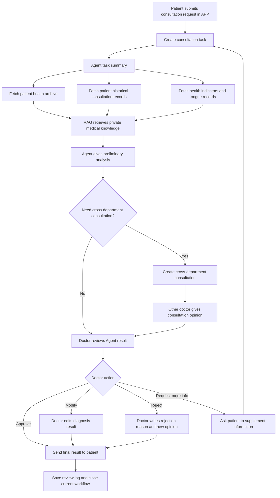
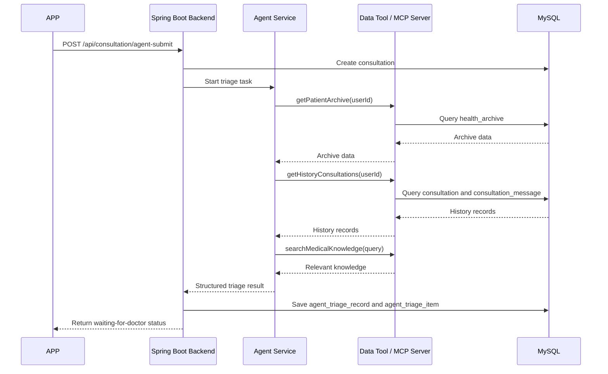
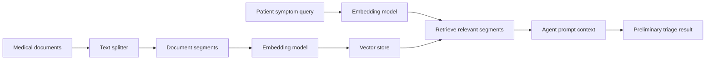
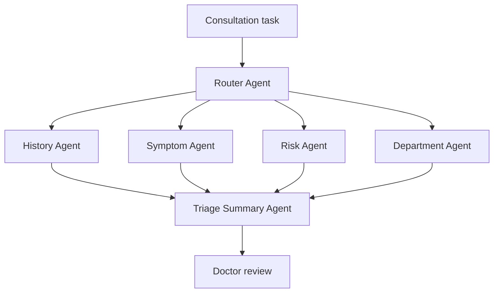
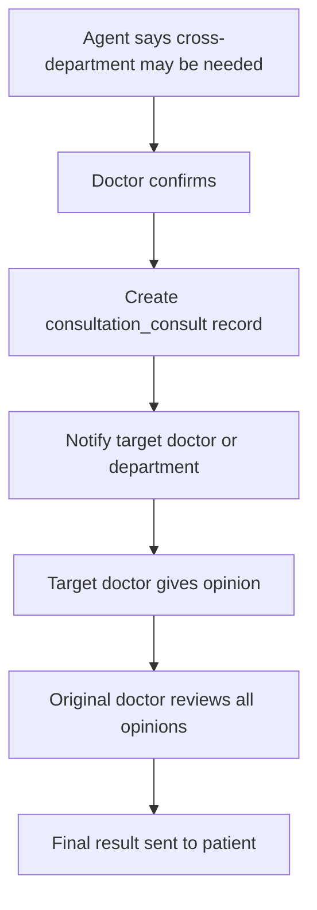

# APP Agent Pre-consultation Workflow Design

## 1. Purpose

This document describes the future APP consultation workflow where a patient submits symptoms, an Agent performs an initial analysis, the result is sent to a doctor, and the doctor reviews, modifies, approves, rejects, or starts a consultation before sending the final response back to the patient.

This workflow is not meant to replace doctors. The Agent only performs pre-consultation triage and information organization. The final medical opinion must be reviewed by a doctor.

## 2. Current System Foundation

The current system already has these related tables and modules:

| Existing table | Current role |
| --- | --- |
| `sys_user` | Stores patients, doctors, and admin users |
| `sys_role` | Stores user roles |
| `sys_user_role` | Connects users and roles |
| `health_archive` | Stores patient health archive |
| `health_question` | Stores AI health Q&A records |
| `doctor_profile` | Stores doctor profile information |
| `consultation` | Stores one consultation request |
| `consultation_message` | Stores messages inside a consultation |

The new Agent workflow can reuse `consultation` as the main consultation record and `consultation_message` as the conversation record. New tables are needed for Agent analysis, doctor review, and cross-department consultation.

## 3. Target Workflow



## 4. Page Flow

### 4.1 Patient APP side

Patient pages should be good-looking and clear. The APP should guide the patient step by step instead of showing a plain form.

Suggested pages:

| Page | Main content |
| --- | --- |
| Consultation start page | Select department or doctor, describe symptoms, upload images |
| Symptom detail page | Duration, pain level, medicine history, allergy history |
| Agent analyzing page | Shows "AI is organizing your symptoms for the doctor" |
| Waiting for doctor review page | Shows status and estimated review progress |
| Doctor result page | Shows doctor's final advice, Agent summary, risk warning, follow-up actions |

### 4.2 Doctor PC/APP side

Doctor pages should focus on efficiency.

Suggested sections:

| Section | Main content |
| --- | --- |
| Patient summary | Basic info, age, gender, health archive |
| Agent preliminary result | Possible causes, risk level, suggested department, suggested questions |
| Historical records | Previous consultation records, AI Q&A, health indicators |
| Doctor action area | Approve, modify, reject, request more info, start consultation |
| Final reply editor | Doctor writes final result sent to patient |

## 5. Agent Responsibilities

The Agent should not produce a final diagnosis directly. It should perform five tasks:

1. Summarize the patient's submitted symptoms.
2. Retrieve patient private data, such as health archive and history.
3. Retrieve medical knowledge from RAG or guideline documents.
4. Produce preliminary analysis, risk level, and recommended next steps.
5. Send structured output to the doctor for review.

Recommended Agent output:

```json
{
  "summary": "Patient reports insomnia and fatigue for one week.",
  "possibleCauses": [
    {
      "name": "Sleep rhythm disorder",
      "confidence": 0.68,
      "reason": "Symptoms are related to recent sleep and stress description."
    }
  ],
  "riskLevel": "medium",
  "suggestedDepartment": "Traditional Chinese Medicine",
  "suggestedQuestions": [
    "Does the patient have chest tightness?",
    "Has the patient taken sleep medicine recently?"
  ],
  "needCrossDepartment": false,
  "disclaimer": "This is only an AI pre-consultation analysis and must be reviewed by a doctor."
}
```

## 6. How the Agent Calls Other Data Services

The Agent should not directly connect to every database table by itself. The safer structure is to expose backend service APIs or MCP tools, then let the Agent call those tools.

Recommended call chain:



### 6.1 MCP style

If MCP is used, the backend or Agent runtime can register tools such as:

| Tool name | Purpose |
| --- | --- |
| `get_patient_archive` | Query `health_archive` |
| `get_health_indicators` | Query `health_indicator_record` |
| `get_tongue_records` | Query `tongue_observation_record` |
| `get_consultation_history` | Query `consultation` and `consultation_message` |
| `search_medical_guidelines` | Search private guideline knowledge base |
| `create_triage_record` | Save Agent result |

The large model decides which tool to call, but the backend controls permissions and data scope.

## 7. How the Agent Uses Private Knowledge

For private medical information and guideline documents, use RAG.

RAG flow:



RAG can include:

| Data source | Example |
| --- | --- |
| Public medical guidelines | Common symptom handling process |
| Hospital internal rules | Department routing rules |
| TCM health knowledge | Constitution, diet, sleep, season care |
| System history | Patient past consultations and AI Q&A |

Private patient data must be filtered by `user_id`. A patient can only use their own data. A doctor can only access patients they are allowed to review.

## 8. How to Handle Complex Diagnosis Flow

The workflow can be split into multiple Agents. Each Agent has its own responsibility.



Suggested agents:

| Agent | Responsibility |
| --- | --- |
| Router Agent | Classifies the consultation task |
| History Agent | Reads patient archive and history records |
| Symptom Agent | Extracts symptoms, duration, severity |
| Risk Agent | Detects urgent or high-risk cases |
| Department Agent | Suggests whether cross-department consultation is needed |
| Triage Summary Agent | Combines all results into a doctor-readable summary |

For the first version, these can be implemented as one Agent with several internal steps. Later, they can be split into real independent Agents.

## 9. Human-in-the-loop Doctor Review

Doctor review is the key safety step.

The doctor can choose one of these actions:

| Action | Meaning | Result |
| --- | --- | --- |
| `APPROVE` | Doctor agrees with Agent result | Send result to patient |
| `MODIFY` | Doctor edits Agent result | Send modified result to patient |
| `REJECT` | Doctor rejects Agent result | Send doctor's own opinion |
| `REQUEST_MORE_INFO` | Doctor asks patient for more information | Workflow returns to patient |
| `START_CONSULTATION` | Doctor starts cross-department consultation | Wait for other doctor opinion |

The system must save every action into an operation log so that the process can be reviewed later.

## 10. Cross-department Consultation

If the Agent or doctor thinks a cross-department consultation is needed, the system creates a consultation task for another doctor or department.

Flow:



The Agent can suggest cross-department consultation, but the doctor should make the final decision.

## 11. Database Tables to Add

### 11.1 `agent_triage_record`

Stores one Agent pre-consultation result.

| Field | Type | Description |
| --- | --- | --- |
| `id` | BIGINT | Primary key |
| `consultation_id` | BIGINT | Related consultation |
| `user_id` | BIGINT | Patient id |
| `doctor_id` | BIGINT | Doctor id |
| `input_text` | VARCHAR(2000) | Patient original symptom text |
| `summary` | VARCHAR(2000) | Agent summary |
| `risk_level` | VARCHAR(20) | low, medium, high |
| `suggested_department` | VARCHAR(100) | Suggested department |
| `need_cross_department` | TINYINT | 0 no, 1 yes |
| `status` | VARCHAR(30) | pending_review, approved, rejected, modified |
| `model_name` | VARCHAR(100) | Model used by Agent |
| `create_time` | TIMESTAMP | Created time |

### 11.2 `agent_triage_item`

Stores detailed possible causes and suggestions.

| Field | Type | Description |
| --- | --- | --- |
| `id` | BIGINT | Primary key |
| `triage_id` | BIGINT | Related `agent_triage_record` |
| `item_type` | VARCHAR(30) | cause, question, advice, warning |
| `content` | VARCHAR(1000) | Detail content |
| `confidence` | DECIMAL(5,2) | Confidence score |
| `sort_order` | INT | Display order |

### 11.3 `doctor_review`

Stores doctor's review result.

| Field | Type | Description |
| --- | --- | --- |
| `id` | BIGINT | Primary key |
| `consultation_id` | BIGINT | Related consultation |
| `triage_id` | BIGINT | Related Agent triage |
| `doctor_id` | BIGINT | Reviewing doctor |
| `action` | VARCHAR(30) | approve, modify, reject, request_more_info, start_consultation |
| `review_content` | VARCHAR(3000) | Final doctor opinion |
| `reject_reason` | VARCHAR(1000) | Reason if rejected |
| `create_time` | TIMESTAMP | Created time |

### 11.4 `consultation_consult`

Stores cross-department consultation records.

| Field | Type | Description |
| --- | --- | --- |
| `id` | BIGINT | Primary key |
| `consultation_id` | BIGINT | Original consultation |
| `from_doctor_id` | BIGINT | Doctor who starts the consultation |
| `to_doctor_id` | BIGINT | Invited doctor |
| `department_name` | VARCHAR(100) | Target department |
| `reason` | VARCHAR(1000) | Reason for consultation |
| `opinion` | VARCHAR(3000) | Opinion from invited doctor |
| `status` | VARCHAR(30) | pending, replied, cancelled |
| `create_time` | TIMESTAMP | Created time |
| `reply_time` | TIMESTAMP | Reply time |

### 11.5 `consultation_review_log`

Stores every operation in the workflow.

| Field | Type | Description |
| --- | --- | --- |
| `id` | BIGINT | Primary key |
| `consultation_id` | BIGINT | Related consultation |
| `operator_id` | BIGINT | User who performed the action |
| `operator_role` | VARCHAR(30) | patient, doctor, agent, admin |
| `action` | VARCHAR(50) | submit, agent_triage, approve, reject, modify, consult |
| `detail` | VARCHAR(3000) | Operation detail |
| `create_time` | TIMESTAMP | Created time |

## 12. Suggested Backend APIs

| API | Method | Purpose |
| --- | --- | --- |
| `/api/consultation/agent-submit` | POST | Patient submits consultation and starts Agent triage |
| `/api/consultation/{id}/triage` | GET | Get Agent triage result |
| `/api/consultation/{id}/doctor-review` | POST | Doctor approves, modifies, rejects, or requests more info |
| `/api/consultation/{id}/consult` | POST | Doctor starts cross-department consultation |
| `/api/consultation/{id}/consult-reply` | POST | Invited doctor replies |
| `/api/consultation/{id}/workflow-log` | GET | View workflow operation log |

## 13. Suggested Status Design

The `consultation` table can keep its original status, but future versions should define clearer statuses.

| Status | Meaning |
| --- | --- |
| `SUBMITTED` | Patient submitted |
| `AGENT_ANALYZING` | Agent is analyzing |
| `WAITING_DOCTOR_REVIEW` | Waiting for doctor review |
| `WAITING_PATIENT_INFO` | Waiting for patient supplement |
| `CONSULTING` | Cross-department consultation in progress |
| `DOCTOR_REVIEWED` | Doctor has reviewed |
| `REPLIED` | Result sent to patient |
| `CLOSED` | Consultation closed |

## 14. Implementation Steps

### Phase 1: Basic Agent pre-consultation

1. Add `agent_triage_record` and `agent_triage_item`.
2. Add API `/api/consultation/agent-submit`.
3. When patient submits symptoms, create `consultation`.
4. Call Agent service to generate preliminary result.
5. Save Agent result.
6. Doctor page shows Agent result.

### Phase 2: Doctor review

1. Add `doctor_review`.
2. Add doctor review API.
3. Add doctor actions: approve, modify, reject, request more info.
4. Save final doctor result into `consultation_message`.
5. Send notification to patient.

### Phase 3: Cross-department consultation

1. Add `consultation_consult`.
2. Allow doctor to invite another doctor or department.
3. Invited doctor replies with opinion.
4. Original doctor combines opinions and sends final result.

### Phase 4: RAG and MCP tools

1. Build private knowledge document library.
2. Split documents into chunks and store embeddings.
3. Expose data tools for patient archive and history records.
4. Let Agent call tools through MCP or backend service APIs.

### Phase 5: Audit and safety

1. Add `consultation_review_log`.
2. Log every Agent and doctor action.
3. Add risk warning rules.
4. Add timeout handling if doctor does not review in time.

## 15. Safety Rules

1. Agent output must be marked as preliminary analysis.
2. Agent result must not be sent to patient as final medical advice without doctor review.
3. High-risk cases should be marked and prioritized.
4. Patient private data can only be queried with permission.
5. Doctor review logs must be saved.
6. Cross-department consultation must record all participating doctors.

## 16. Defense Explanation

If asked how this Agent consultation workflow works, answer:

> In the future APP consultation module, the patient first submits symptoms. The backend creates a consultation record and starts an Agent triage task. The Agent retrieves the patient's health archive, historical consultation records, health indicators, and private knowledge base through backend tools or MCP. Then it generates a preliminary analysis, risk level, possible causes, and suggested department. This result is not directly sent to the patient. It is first sent to the doctor. The doctor can approve, modify, reject, request more information, or start a cross-department consultation. Only after doctor review will the final result be returned to the patient.

If asked why new tables are needed, answer:

> Existing tables can store basic consultation records and messages, but Agent triage, doctor review, cross-department consultation, and workflow logs are independent business data. Therefore, new tables such as `agent_triage_record`, `agent_triage_item`, `doctor_review`, `consultation_consult`, and `consultation_review_log` are needed to keep the process clear, traceable, and easy to maintain.

If asked how the large model calls other data services, answer:

> The large model should not directly access the database. The backend exposes controlled tools or MCP services, such as getting patient archives, historical consultations, health indicators, and medical knowledge retrieval. The Agent calls these tools, receives structured data, and then generates a preliminary result. This design keeps permission control in the backend and makes the Agent workflow safer.
