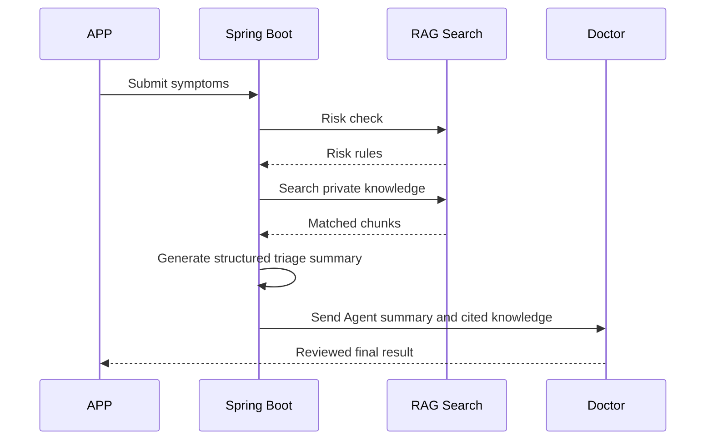

# RAG Private Knowledge Base Next Steps Roadmap

## 1. Current Status

The project has already completed the database foundation for the APP production RAG knowledge base.

Completed files:

| File | Purpose |
| --- | --- |
| `D:\SpringBoot\SpringBootDemo\src\main\resources\db\rag-private-knowledge-base.sql` | Basic RAG knowledge tables |
| `D:\SpringBoot\SpringBootDemo\src\main\resources\db\rag-production-tables.sql` | Production governance tables |
| `D:\SpringBoot\SpringBootDemo\src\main\resources\db\rag-app-launch-seed-data.sql` | First APP launch seed knowledge data |
| `D:\SpringBoot\SpringBootDemo\src\main\java\org\example\springbootdemo\config\PrivateKnowledgeBaseInitializer.java` | Auto-create tables and auto-import seed data on backend startup |
| `D:\SpringBoot\SpringBootDemo\docs\rag-production-architecture.md` | Production RAG architecture and Milvus planning |

The current database is no longer only empty tables. After Spring Boot starts successfully, it should automatically insert the first batch of knowledge data.

## 2. First Thing To Do

Start the backend once so the initializer can connect to MySQL and write the RAG tables and seed data.

```powershell
cd D:\SpringBoot\SpringBootDemo
mvn spring-boot:run
```

Before startup, confirm:

1. MySQL is running.
2. Database `yangsheng_db` exists.
3. `D:\SpringBoot\SpringBootDemo\src\main\resources\application.yml` has the correct username and password.

Current config:

```yaml
spring:
  datasource:
    url: jdbc:mysql://localhost:3306/yangsheng_db?useUnicode=true&characterEncoding=utf8&serverTimezone=Asia/Shanghai
    username: root
    password: 123456
```

## 3. Verify Data After Startup

After Spring Boot starts, run these SQL checks in MySQL.

```sql
select count(*) as category_count from medical_knowledge_category;
select count(*) as document_count from medical_knowledge_document;
select count(*) as chunk_count from medical_knowledge_chunk;
select count(*) as review_count from knowledge_review;
select count(*) as quality_count from knowledge_quality_score;
select count(*) as embedding_task_count from knowledge_embedding_task;
select count(*) as version_item_count from knowledge_version_item;
```

Expected result:

| Table | Expected |
| --- | --- |
| `medical_knowledge_category` | Has multiple categories |
| `medical_knowledge_document` | Has first batch documents |
| `medical_knowledge_chunk` | Has first batch knowledge chunks |
| `knowledge_review` | Has approved review records |
| `knowledge_quality_score` | Has quality score records |
| `knowledge_embedding_task` | Has pending embedding tasks |
| `knowledge_version_item` | Has version item records |

Sample check:

```sql
select id, title, medicine_system, source_type
from medical_knowledge_document
order by id desc
limit 20;

select id, title, risk_level, embedding_status
from medical_knowledge_chunk
order by id desc
limit 20;
```

## 4. What To Build Next

The next goal is to make the data usable by the APP and Agent.

Recommended order:

```text
1. Knowledge search API
2. Risk warning API
3. Knowledge management/admin page
4. Milvus vector database
5. Hybrid retrieval service
6. Agent consultation integration
```

## 5. Step 1: Knowledge Search API

Purpose:

Let the frontend, APP, and Agent search the private knowledge base.

Suggested endpoint:

```http
GET /api/knowledge/search?keyword=失眠
GET /api/knowledge/search?keyword=胸痛
GET /api/knowledge/search?keyword=低血糖
```

The backend should return:

| Field | Meaning |
| --- | --- |
| `chunkId` | Knowledge chunk id |
| `title` | Chunk title |
| `content` | Knowledge content |
| `riskLevel` | LOW, MEDIUM, HIGH, EMERGENCY |
| `medicineSystem` | TCM, WESTERN, INTEGRATED, GENERAL |
| `sourceName` | Knowledge source |
| `reviewStatus` | Doctor review status |
| `finalScore` | Retrieval score |

Recommended SQL idea:

```sql
select c.id,
       c.title,
       c.content,
       c.keywords,
       c.risk_level,
       d.medicine_system,
       d.source_name
from medical_knowledge_chunk c
join medical_knowledge_document d on c.document_id = d.id
where c.enabled = 1
  and d.status = 'ACTIVE'
  and (
    c.title like concat('%', ?, '%')
    or c.content like concat('%', ?, '%')
    or c.keywords like concat('%', ?, '%')
  )
order by
  case c.risk_level
    when 'EMERGENCY' then 1
    when 'HIGH' then 2
    when 'MEDIUM' then 3
    else 4
  end,
  c.sort_order asc
limit 10;
```

Every search should write logs:

| Table | What to write |
| --- | --- |
| `medical_knowledge_search_log` | Query text, scene, user id, matched ids |
| `rag_retrieval_result` | Each matched chunk, score, rank, retrieval type |

## 6. Step 2: Risk Warning API

Purpose:

Medical risk warning must run before ordinary knowledge search.

Suggested endpoint:

```http
POST /api/knowledge/risk-check
```

Request:

```json
{
  "text": "胸痛、冷汗、气短",
  "scene": "AGENT_TRIAGE"
}
```

Response:

```json
{
  "riskLevel": "EMERGENCY",
  "matchedRules": [
    {
      "ruleCode": "CHEST_PAIN_EMERGENCY",
      "name": "胸痛急症预警",
      "action": "CALL_EMERGENCY",
      "suggestion": "建议立即急救或急诊评估"
    }
  ],
  "doctorReviewRequired": true
}
```

Rules come from:

```text
medical_risk_rule
```

Important rule:

```text
If risk is EMERGENCY, do not only return wellness advice.
Emergency safety guidance must be returned first.
```

## 7. Step 3: Knowledge Management Page

The APP needs an admin or doctor-side management page later.

Recommended pages:

| Page | Purpose |
| --- | --- |
| Knowledge dashboard | View total documents, chunks, reviews, embedding tasks |
| Knowledge list | Search and filter knowledge documents |
| Chunk review page | Doctor approves, rejects, or modifies knowledge chunks |
| Import task page | Upload and track knowledge import tasks |
| Embedding task page | Track vector generation status |
| Retrieval log page | See what knowledge was used by Agent |

Important filters:

```text
category
medicine_system
risk_level
review_status
embedding_status
source_type
version_no
```

## 8. Step 4: Milvus Vector Database

After MySQL data is stable, connect Milvus.

Recommended architecture:

```text
MySQL stores original knowledge and review status.
Milvus stores vector embeddings.
Spring Boot combines MySQL metadata and Milvus vector search results.
```

Milvus collection:

```text
medical_knowledge_chunk_vector
```

Recommended fields:

| Field | Meaning |
| --- | --- |
| `vector_id` | Vector primary key |
| `chunk_id` | MySQL chunk id |
| `document_id` | MySQL document id |
| `category_code` | Category |
| `medicine_system` | TCM, WESTERN, INTEGRATED, GENERAL |
| `risk_level` | LOW, MEDIUM, HIGH, EMERGENCY |
| `version_no` | Knowledge version |
| `enabled` | Whether searchable |
| `embedding` | Float vector |

Embedding tasks are already prepared in:

```text
knowledge_embedding_task
```

## 9. Step 5: Hybrid Retrieval

Final APP retrieval should not use only keywords or only vectors.

Use:

```text
keyword search
+ vector search
+ risk rule matching
+ doctor review status
+ source authority
+ quality score
```

Suggested final score:

```text
final_score =
  vector_score * 0.55
  + keyword_score * 0.25
  + source_authority_score * 0.10
  + quality_score * 0.10
```

Emergency rules override normal ranking.

## 10. Step 6: Agent Consultation Integration

When patient submits symptoms:



Agent output should include:

| Field | Meaning |
| --- | --- |
| `summary` | Symptom summary |
| `missingInfo` | Information still needed |
| `riskLevel` | Risk level |
| `possibleDirections` | Possible direction, not final diagnosis |
| `suggestedQuestions` | Follow-up questions |
| `suggestedDepartment` | Suggested department |
| `knowledgeReferences` | Cited knowledge chunks |
| `disclaimer` | Must be reviewed by doctor |

## 11. Launch Safety Rules

For production APP:

1. Agent must not directly give final diagnosis.
2. Doctor review is required before sending medical advice to patient.
3. Emergency warnings must be shown before wellness suggestions.
4. Patient private records must not be mixed into public knowledge.
5. Historical Q&A must be desensitized before becoming reusable knowledge.
6. Every Agent result must keep knowledge references.
7. Every retrieval must be logged.
8. Outdated or rejected knowledge must not be used.

## 12. Recommended Immediate Next Task

The best next development task is:

```text
Build Knowledge Search API + Risk Warning API
```

Because:

1. The database and first seed data already exist.
2. The frontend and Agent cannot use the database without APIs.
3. Risk warning is required before normal AI/Agent answers.
4. Milvus should wait until MySQL chunks are stable.

Suggested backend files for next implementation:

| File | Purpose |
| --- | --- |
| `controller/KnowledgeController.java` | Expose search and risk-check APIs |
| `service/KnowledgeSearchService.java` | Search chunks, match risk rules, write logs |
| `dao/MedicalKnowledgeDao.java` | MyBatis mapper interface |
| `resources/org.example.springbootdemo/MedicalKnowledgeDao.xml` | SQL queries |
| `bean/KnowledgeSearchResult.java` | Search result DTO |
| `bean/RiskCheckResult.java` | Risk check DTO |

## 13. Simple Development Order

```text
1. Start Spring Boot once and confirm seed data is in MySQL.
2. Add KnowledgeSearchService.
3. Add MyBatis SQL for keyword search.
4. Add risk rule matching.
5. Add KnowledgeController.
6. Add tests.
7. Connect frontend/admin page.
8. Add Milvus after API works.
```
