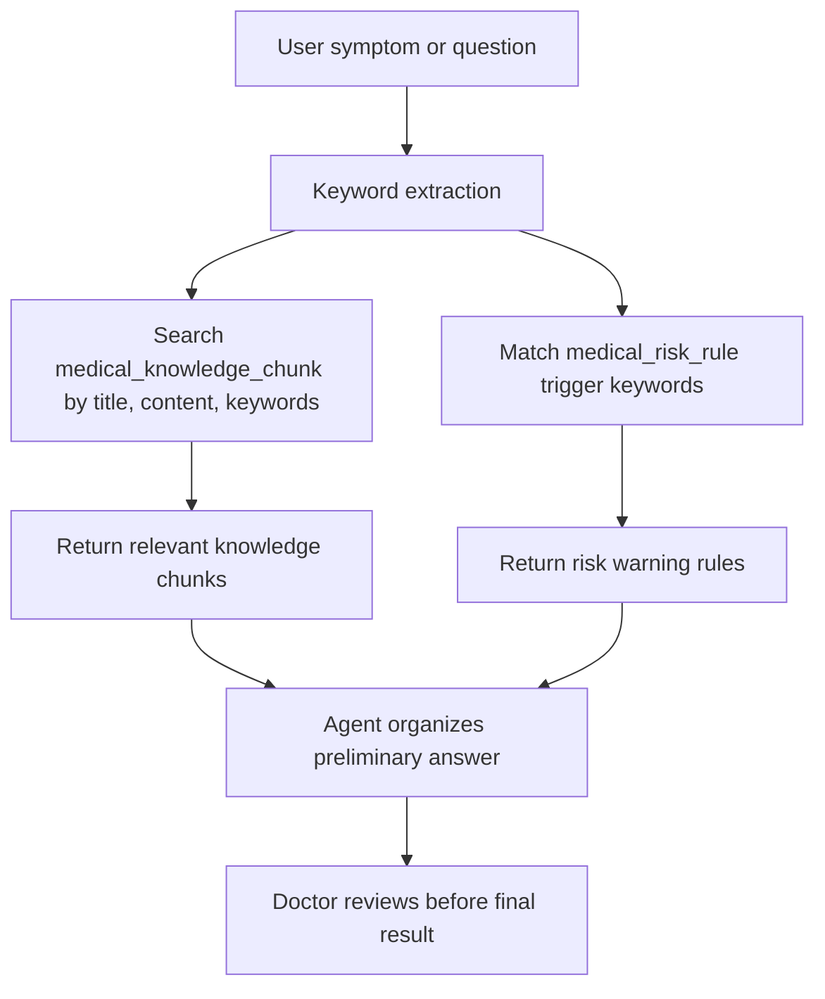

# RAG Private Knowledge Base Implementation

## 1. What Was Built

This project now has a first-version private medical knowledge database.

It is designed for the future APP Agent consultation workflow. It stores TCM knowledge, western medicine knowledge, integrated medicine rules, wellness guidance, risk warning rules, retrieval logs, and Agent knowledge references.

This version does not depend on an external large model or an external vector database. It is a local MySQL-based private knowledge base. For APP launch, the project has also added production governance tables and Milvus planning in `D:\SpringBoot\SpringBootDemo\docs\rag-production-architecture.md`.

## 2. File Locations

| File | Purpose |
| --- | --- |
| `D:\SpringBoot\SpringBootDemo\src\main\resources\db\rag-private-knowledge-base.sql` | Manual MySQL table creation and seed data script |
| `D:\SpringBoot\SpringBootDemo\src\main\java\org\example\springbootdemo\config\PrivateKnowledgeBaseInitializer.java` | Spring Boot startup initializer; creates tables and inserts first seed data when empty |
| `D:\SpringBoot\SpringBootDemo\src\test\java\org\example\springbootdemo\config\PrivateKnowledgeBaseInitializerTest.java` | Unit tests for table creation and seed skipping |
| `D:\SpringBoot\SpringBootDemo\docs\rag-private-knowledge-base.md` | Implementation explanation and defense notes |

## 3. Database Tables

### 3.1 `medical_knowledge_category`

Stores knowledge categories.

Examples:

| Code | Meaning |
| --- | --- |
| `TCM` | TCM knowledge |
| `WESTERN` | Western medicine knowledge |
| `INTEGRATED` | Integrated TCM and western medicine |
| `WELLNESS` | Lifestyle and health management |
| `RISK_WARNING` | Emergency and risk warning rules |
| `APP_AGENT` | Agent consultation workflow knowledge |

### 3.2 `medical_knowledge_document`

Stores document-level knowledge sources.

Examples:

| Title | System |
| --- | --- |
| 中医体质与日常养生基础 | TCM |
| 常见症状西医风险识别 | Western medicine |
| 中西医结合健康问诊规则 | Integrated medicine |
| 生活方式健康管理基础 | General health management |

### 3.3 `medical_knowledge_chunk`

Stores searchable knowledge fragments. This is the core retrieval table.

Important fields:

| Field | Meaning |
| --- | --- |
| `content` | Real knowledge text |
| `keywords` | Keyword retrieval words |
| `intent_tags` | Used for Agent scene matching |
| `risk_level` | LOW, MEDIUM, HIGH, EMERGENCY |
| `embedding_status` | Reserved for future vector generation |
| `vector_id` | Reserved for future vector database id |

First-version chunks include:

| Topic | Example use |
| --- | --- |
| 中医体质辨识边界 | Explains that constitution analysis is not a diagnosis |
| 气虚与疲劳 | Handles fatigue and low-energy wellness questions |
| 阴虚与睡眠 | Handles insomnia, dry mouth, irritability, night sweating |
| 胸痛和心梗危险信号 | Detects high-risk chest pain |
| 卒中危险信号 | Detects stroke warning signs |
| 血压异常 | Handles high blood pressure boundary cases |
| 中西医结合问诊输出原则 | Guides Agent triage output |
| 问诊补充信息 | Guides follow-up questions |
| 健康饮食 | Lifestyle guidance |
| 运动安全边界 | Exercise suggestions and warning signs |

### 3.4 `medical_risk_rule`

Stores rule-based warning conditions.

First-version rules:

| Rule code | Meaning |
| --- | --- |
| `CHEST_PAIN_EMERGENCY` | Chest pain emergency warning |
| `STROKE_EMERGENCY` | Stroke warning |
| `BREATHING_EMERGENCY` | Breathing difficulty warning |
| `HIGH_FEVER_WARNING` | High fever warning |
| `BLOOD_PRESSURE_WARNING` | Blood pressure warning |
| `MENTAL_HEALTH_WARNING` | Mental health crisis warning |

### 3.5 `medical_knowledge_search_log`

Stores search logs. It records who searched, what was searched, which chunks matched, and which scene used the search.

Typical scenes:

| Scene | Meaning |
| --- | --- |
| `AI_CHAT` | AI health Q&A |
| `AGENT_TRIAGE` | APP Agent pre-consultation |
| `DOCTOR_REVIEW` | Doctor review page |
| `APP_SEARCH` | APP knowledge search |

### 3.6 `agent_knowledge_reference`

Stores which knowledge chunks were used by an Agent or AI answer.

This is important for traceability. In the future, when a doctor reviews an Agent result, the system can show: "The Agent referenced these private knowledge chunks."

## 4. First-Version Retrieval Logic

The first version can work without a vector database.

Recommended retrieval flow:



Example SQL:

```sql
SELECT c.id, c.title, c.content, c.keywords, c.risk_level, d.medicine_system
FROM medical_knowledge_chunk c
JOIN medical_knowledge_document d ON c.document_id = d.id
WHERE c.enabled = 1
  AND (
    c.title LIKE CONCAT('%', ?, '%')
    OR c.content LIKE CONCAT('%', ?, '%')
    OR c.keywords LIKE CONCAT('%', ?, '%')
  )
ORDER BY
  CASE c.risk_level
    WHEN 'EMERGENCY' THEN 1
    WHEN 'HIGH' THEN 2
    WHEN 'MEDIUM' THEN 3
    ELSE 4
  END,
  c.sort_order ASC
LIMIT 5;
```

## 5. Why No Vector Database in Version 1

Version 1 focuses on making the private database complete and stable.

Reasons:

1. The current system uses Spring Boot + MyBatis + MySQL, so MySQL is the lowest-risk first step.
2. The system can start and run without installing Milvus, FAISS, Chroma, or pgvector.
3. Defense explanation is clearer: private database first, vector retrieval later.
4. Fields are already reserved for vector upgrade through `embedding_status` and `vector_id`.

## 6. Future Upgrade Path

When the APP Agent workflow is implemented, the next steps are:

1. Add a `MedicalKnowledgeSearchService`.
2. Add keyword retrieval API, for example `/api/knowledge/search`.
3. Connect Agent triage to the search service.
4. Save matched chunks to `agent_knowledge_reference`.
5. Add local embedding model or vector database.
6. Change retrieval from keyword matching to hybrid retrieval: keyword + vector + risk rule.

Recommended vector database choices later:

| Option | When to use |
| --- | --- |
| FAISS | Local prototype or graduation project enhancement |
| Chroma | Fast RAG prototype |
| Milvus | More formal production-style vector service |
| pgvector | If the database is changed to PostgreSQL |

## 7. Defense Explanation

If asked "What is the private knowledge base?", answer:

> The private knowledge base is the medical knowledge data layer prepared for the system's intelligent consultation module. It stores TCM knowledge, western medicine knowledge, integrated medicine rules, wellness guidance, and emergency warning rules. The Agent does not directly invent answers. It first retrieves relevant knowledge from this private database, then organizes a preliminary result for doctor review.

If asked "Is this your own large model?", answer:

> Strictly speaking, this is not a general large model trained from zero. It is a system-specific intelligent consultation model built from private knowledge, retrieval rules, risk rules, and consultation workflow control. This is more practical for the current project because it can run locally, is controllable, and supports doctor review.

If asked "Do you need a vector database?", answer:

> Version 1 does not require a vector database. It uses MySQL categories, keywords, full-text fields, and risk rules to support retrieval. However, the table already reserves `embedding_status` and `vector_id`, so the system can later connect to FAISS, Milvus, Chroma, or pgvector for semantic retrieval.

If asked "How does this help Agent consultation?", answer:

> When a patient submits symptoms, the Agent can search the private knowledge base for related TCM, western medicine, and risk warning knowledge. It then generates a preliminary summary, possible risk level, suggested follow-up questions, and suggested department. The result is not directly sent to the patient; it is sent to the doctor for review, modification, approval, or consultation.
