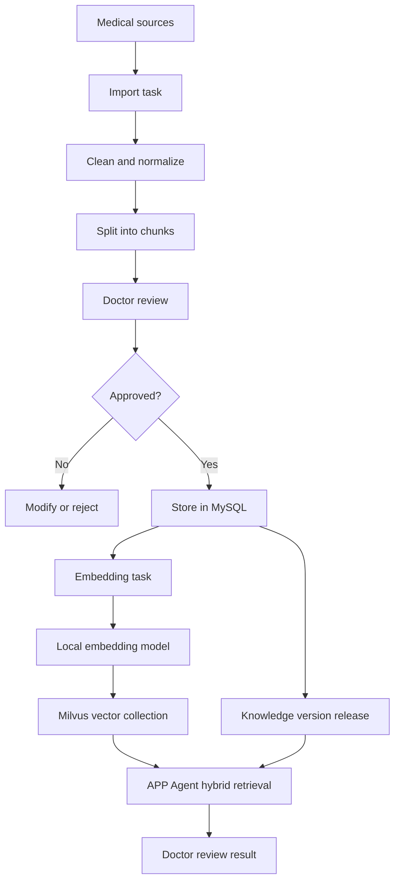
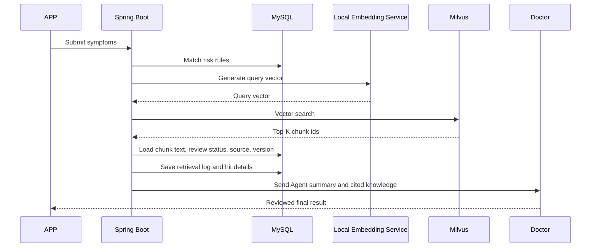

# APP Production RAG Knowledge Base Architecture

## 1. Goal

The APP launch version should not use a small demo knowledge base. It needs a production-grade RAG knowledge system with:

1. Large-scale TCM, western medicine, and integrated medicine knowledge.
2. Clear knowledge source management.
3. Doctor or expert review before online use.
4. Knowledge version release and rollback.
5. MySQL for business and governance data.
6. Milvus for vector search.
7. Full retrieval traceability for doctor review and safety audit.

## 2. Current Upgrade

The first-version knowledge tables are retained:

| Table | Purpose |
| --- | --- |
| `medical_knowledge_category` | Knowledge categories |
| `medical_knowledge_document` | Knowledge documents |
| `medical_knowledge_chunk` | Searchable knowledge chunks |
| `medical_risk_rule` | Medical warning rules |
| `medical_knowledge_search_log` | Search logs |
| `agent_knowledge_reference` | Agent knowledge references |

Production governance tables have been added:

| Table | Purpose |
| --- | --- |
| `knowledge_source` | Source authority, organization, URL, license note |
| `knowledge_review` | Doctor/expert review records |
| `knowledge_version` | Knowledge base release versions |
| `knowledge_version_item` | Documents/chunks included in a release |
| `knowledge_import_task` | Knowledge import, parsing, cleaning, chunking task |
| `knowledge_embedding_task` | Embedding generation and Milvus sync task |
| `knowledge_feedback` | User/doctor feedback for quality improvement |
| `knowledge_quality_score` | Accuracy, safety, freshness, usage statistics |
| `rag_retrieval_result` | Detailed retrieval hit records and scores |

SQL file:

`D:\SpringBoot\SpringBootDemo\src\main\resources\db\rag-production-tables.sql`

Spring Boot initializer:

`D:\SpringBoot\SpringBootDemo\src\main\java\org\example\springbootdemo\config\PrivateKnowledgeBaseInitializer.java`

## 3. Production Data Flow



## 4. Knowledge Scale for APP Launch

上线 APP 不建议只放几十条知识。建议按知识片段数量规划：

| Stage | Chunk count | Goal |
| --- | ---: | --- |
| Internal alpha | 1,000 - 3,000 | Cover common consultation and warning scenarios |
| Closed beta | 5,000 - 20,000 | Cover common TCM, western medicine, and chronic disease management |
| Public launch | 30,000+ | Wider disease/symptom coverage, versioned updates, doctor-reviewed Q&A |

Suggested content groups:

| Group | Examples |
| --- | --- |
| TCM constitution | 平和质、气虚质、阳虚质、阴虚质、痰湿质、湿热质、血瘀质、气郁质、特禀质 |
| TCM wellness | 节气养生、睡眠、脾胃、情志、饮食、运动、经络、常见不适调理 |
| Western symptoms | 发热、咳嗽、胸痛、腹痛、头痛、眩晕、呼吸困难、失眠、焦虑 |
| Chronic disease | 高血压、糖尿病、冠心病、血脂异常、肥胖、慢性胃炎 |
| Integrated medicine | Same symptom with western risk recognition and TCM wellness guidance |
| Risk rules | 胸痛、卒中、呼吸困难、高热、低血糖、血压危象、心理危机 |
| Consultation rules | Symptom follow-up questions, department routing, doctor review boundaries |

## 5. MySQL and Milvus Responsibilities

Milvus does not replace MySQL.

| System | Responsibility |
| --- | --- |
| MySQL | Knowledge text, source, review status, version, quality score, logs |
| Milvus | Vector index and semantic similarity search |
| Spring Boot | Permission, workflow, review, API, logs, hybrid ranking |
| Local embedding service | Convert text and query into vectors |

## 6. Milvus Collection Design

Recommended collection name:

`medical_knowledge_chunk_vector`

Recommended fields:

| Field | Type | Meaning |
| --- | --- | --- |
| `vector_id` | VarChar primary key | Same as `medical_knowledge_chunk.vector_id` |
| `chunk_id` | Int64 | MySQL chunk id |
| `document_id` | Int64 | MySQL document id |
| `category_code` | VarChar | TCM, WESTERN, INTEGRATED, etc. |
| `medicine_system` | VarChar | TCM, WESTERN, INTEGRATED, GENERAL |
| `risk_level` | VarChar | LOW, MEDIUM, HIGH, EMERGENCY |
| `version_no` | VarChar | Knowledge version |
| `enabled` | Bool | Whether the vector can be searched |
| `embedding` | FloatVector | Dense vector from local embedding model |

Dimension depends on the local embedding model.

Examples:

| Embedding model | Typical dimension |
| --- | ---: |
| bge-small-zh-v1.5 | 512 |
| bge-base-zh-v1.5 | 768 |
| bge-large-zh-v1.5 | 1024 |

Pick one model and keep the dimension fixed. Do not mix different dimensions in the same Milvus collection.

## 7. Milvus Deployment

Official Milvus docs show two standalone options:

1. Docker single container script.
2. Docker Compose standalone with Milvus, MinIO, and etcd.

For APP launch preparation, Docker Compose standalone is better than a single container because it separates Milvus metadata and object storage dependencies.

Official Docker Compose command from Milvus docs:

```bash
wget https://github.com/milvus-io/milvus/releases/download/v3.0-beta/milvus-standalone-docker-compose.yml -O docker-compose.yml
sudo docker compose up -d
```

After startup, official docs say these containers should exist:

| Container | Purpose |
| --- | --- |
| `milvus-standalone` | Milvus vector service |
| `milvus-minio` | Object storage |
| `milvus-etcd` | Metadata storage |

Default ports:

| Port | Purpose |
| --- | --- |
| `19530` | Milvus SDK/API access |
| `9091` | Milvus WebUI |

WebUI:

`http://127.0.0.1:9091/webui/`

Official references:

- https://milvus.io/docs/install_standalone-docker-compose.md
- https://milvus.io/docs/schema.md
- https://milvus.io/docs/index.md

## 8. Backend Integration Steps

### Step 1: Import knowledge into MySQL

Create `knowledge_import_task`.

Parse sources:

```text
PDF / DOCX / Markdown / manual input / reviewed Q&A
```

Store document and chunk records:

```text
medical_knowledge_document
medical_knowledge_chunk
```

### Step 2: Doctor review

Each important document/chunk must create `knowledge_review`.

Only approved chunks enter online retrieval.

Recommended online condition:

```sql
chunk.enabled = 1
AND EXISTS (
  SELECT 1
  FROM knowledge_review r
  WHERE r.chunk_id = chunk.id
    AND r.review_status = 'APPROVED'
)
```

### Step 3: Generate embeddings

Create `knowledge_embedding_task` for each approved chunk.

Embedding service:

```text
Input: chunk content
Output: float vector
```

Then insert vector into Milvus and update MySQL:

```text
medical_knowledge_chunk.embedding_status = EMBEDDED
medical_knowledge_chunk.vector_id = generated vector id
knowledge_embedding_task.task_status = SUCCESS
```

### Step 4: APP Agent retrieval

When a patient asks a question:



### Step 5: Hybrid ranking

Do not rely on vector score only.

Recommended final score:

```text
final_score =
  vector_score * 0.55
  + keyword_score * 0.25
  + source_authority_score * 0.10
  + quality_score * 0.10
```

Emergency risk rules should override normal ranking.

## 9. Safety Requirements

For APP launch, enforce these rules:

1. Emergency warnings must be detected before normal RAG answer generation.
2. Agent output must not be final medical diagnosis.
3. Doctor-reviewed content should have higher priority.
4. Every answer must be traceable to chunks, source, version, and retrieval log.
5. Retired knowledge versions must not be used.
6. Patient private data must not be mixed into public medical knowledge.
7. User consultation history can be retrieved only with permission filtering.
8. Knowledge from historical Q&A must be desensitized before becoming reusable platform knowledge.

## 10. Launch Roadmap

| Phase | Deliverable |
| --- | --- |
| Phase 1 | Production MySQL governance tables |
| Phase 2 | Admin knowledge import and doctor review backend |
| Phase 3 | Local embedding service |
| Phase 4 | Milvus collection and vector sync |
| Phase 5 | Hybrid retrieval API |
| Phase 6 | Agent consultation integration |
| Phase 7 | Monitoring, feedback, rollback, quality scoring |

## 11. How to Explain It

上线版可以这样讲：

> APP 上线版不会只依赖少量固定知识，也不会只靠关键词检索。系统采用 MySQL + Milvus 的 RAG 架构。MySQL 保存医学知识原文、来源、医生审核、版本、质量评分和检索日志；Milvus 保存知识片段向量，用于语义检索。用户提交症状后，后端先进行风险规则判断，再做关键词和向量混合检索，最后将命中的知识片段和 Agent 初步分析一起交给医生审核，医生审核后才返回给患者。
