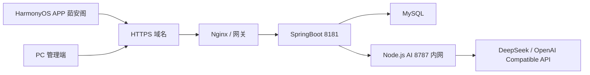

# 茹安阁后端生产化与 AI 合并路线

更新时间：2026-06-27

## 结论

上线第一版建议采用：

**APP / PC 只连接 SpringBoot，SpringBoot 统一对外提供 HTTPS API，Node.js 只作为内网 AI 编排服务。**

也就是说：

- APP 不直接访问 `8787`。
- PC 不直接访问 `8787`。
- 用户、医生、管理员、健康档案、问诊、问答记录全部以 SpringBoot 为主后端。
- LLM、Prompt、LangGraph 暂时保留在 Node.js 服务中。
- SpringBoot 通过 `NodeAssistantOrchestrationClient` 调用 Node.js。
- 后续如果需要真正“物理合并”，再把 Prompt/LangGraph 能力逐步迁入 Java 或独立 AI 服务。

这个方案比直接把 Node.js 代码硬迁进 SpringBoot 更适合当前阶段，因为 LangGraph、Prompt 编排和 LLM 调用本来就是 Node 生态代码，强行迁移容易引入新 bug。

## 当前已具备的基础

SpringBoot 后端已经存在：

- `NodeAssistantOrchestrationClient`
- `NodeAiOrchestrationProperties`
- `AssistantChatService`
- `AssistantSuggestionService`
- `AssistantController`
- `HealthQuestionAiService`
- `HealthQuestionPromptBuilderAdapter`

配置中已经有：

```yaml
app:
  node-ai:
    base-url: ${NODE_AI_BASE_URL:http://127.0.0.1:8787}
    timeout-ms: ${NODE_AI_TIMEOUT_MS:6000}
```

这说明当前架构已经是“SpringBoot 桥接 Node AI”的方向，不需要 APP 同时连两个后端。

## 推荐部署架构



## AI 合并策略

### 第一阶段：逻辑合并，立即采用

目标：APP 和 PC 只面对 SpringBoot。

要求：

- APP 默认后端只配置 SpringBoot HTTPS 地址。
- PC 默认后端只配置 SpringBoot HTTPS 地址。
- Node 服务只允许 SpringBoot 访问。
- Node 的 `8787` 不对公网开放。
- SpringBoot 负责鉴权、记录问答、限流、错误兜底。
- Node 只负责 LLM、Prompt、LangGraph 编排。

效果：

- 用户看到的是一个统一后端。
- 运维上是两个进程或两个容器。
- 代码风险最低。

### 第二阶段：部署合并，推荐上线前完成

目标：两个后端由同一个部署脚本或同一个服务器管理。

要求：

- SpringBoot 和 Node 都使用环境变量配置。
- `NODE_AI_BASE_URL` 在生产环境设置为内网地址，例如 `http://127.0.0.1:8787`。
- 用同一个启动脚本、systemd、Docker Compose 或宝塔进程守护管理两个服务。
- Node 崩溃时自动重启。
- SpringBoot 调 Node 失败时返回可读错误，并保留本地兜底回复。

### 第三阶段：物理合并，后续再做

目标：减少服务数量。

可选方向：

- 把 Prompt 生成逻辑迁入 SpringBoot。
- 把 LangGraph 编排改成 Java 实现。
- 或者保留 Node AI 服务，但将它作为独立 AI 微服务长期维护。

当前不建议马上做，因为迁移成本高，且会拖慢 APP 上线。

## 后端生产化清单

### 数据库备份

必须做：

- 每天自动备份 `yangsheng_db`。
- 备份文件按日期命名。
- 至少保留最近 7 天。
- 上线前手动验证一次恢复。

推荐命令示例：

```bash
mysqldump -u root -p yangsheng_db > backups/yangsheng_db_$(date +%F).sql
```

Windows 可用 PowerShell 定时任务或服务器面板计划任务实现。

### 后端日志

必须做：

- SpringBoot 日志写入文件。（基础版已完成：`prod` 环境写入 `logs/ruange-app.log` 和 `logs/ruange-error.log`，按日期和大小滚动）
- 区分 `dev` 和 `prod` 日志级别。
- 生产环境不能一直使用 `debug`。
- AI 请求只记录用户 ID、请求时间、模型、耗时、结果状态，不记录完整隐私内容到普通日志。

建议：

- `logs/ruange-app.log`
- `logs/ruange-error.log`
- 每天滚动，并按单文件大小切分。
- 基础版保留 30 天。

### 异常告警

第一版可以先做简化版：

- SpringBoot 捕获全局异常，返回统一 JSON。（基础版已完成：400 参数错误、404 资源不存在、500 服务器异常均返回 `success/message`，不向 APP 暴露堆栈）
- AI 服务异常时记录错误日志。
- 数据库连接失败时启动失败或健康检查失败。
- `/api/health` 返回数据库、Node AI、天气服务的状态。

后续增强：

- 邮件、企业微信、钉钉、短信告警。
- 5 分钟内 5xx 超过阈值触发告警。
- Node AI 连续不可用触发告警。

### 账号权限校验

基础版已完成：

- `/api/user` 新增用户接口已限制为管理员。
- `/api/user/list`、删除用户接口已限制为管理员。
- `/api/role`、`/api/role/list`、角色新增、编辑、删除已限制为管理员。
- `/api/user-role`、`/api/user-role/list`、用户角色新增、编辑、删除已限制为管理员。
- 健康档案、健康明细、问答记录、问诊记录已有用户归属或管理员校验。

上线前仍需真机回归：

- 除登录、注册、健康检查外，业务接口必须校验 token。
- 管理员接口必须校验 `ADMIN` 角色。
- 医生接口必须校验 `DOCTOR` 角色。
- 普通用户只能访问自己的健康档案、问诊、问答记录。
- 医生只能访问向自己发起的问诊。
- 管理员可以查看全量数据。

重点检查接口：

- `/api/users`
- `/api/roles`
- `/api/user-roles`
- `/api/health-question/list`
- `/api/consultations/admin/**`
- `/api/consultations/doctor/**`
- `/api/health-archive/**`
- `/api/health-detail/**`

### HTTPS

必须做：

- APP 正式包默认后端地址改为 HTTPS 域名。
- Nginx 或网关配置 SSL 证书。
- SpringBoot 可以只监听内网 `8181`。
- Node 只监听本机或内网 `8787`。
- 生产环境禁止 APP 直接访问 `http://公网IP:8181`。

推荐结构：

```text
https://api.ruange.example.com -> Nginx -> http://127.0.0.1:8181
```

### AI 接口限流

基础版已完成：

- `/api/ai/chat` 已限制单次问题最多 1000 字。
- `/api/ai/chat` 已按用户和接口做每分钟限流。
- `/api/ai/suggestions` 已按用户和接口做每分钟限流。
- 超限会返回 `429` 和统一提示：`AI请求过于频繁，请稍后再试`。

仍建议上线前继续增强：

- 对 `/api/ai/chat` 做按用户限流。
- 对 `/api/ai/suggestions` 做按用户限流。
- 未登录不能调用 AI。
- 管理员可查看问答记录，但不能绕过限流无限刷模型。

第一版建议阈值：

- 普通用户：每分钟 5 次，每天 100 次。
- 医生：每分钟 10 次，每天 200 次。
- 管理员：每分钟 10 次，每天 200 次。
- 单次问题长度限制：1000 字以内。
- 上下文历史限制：最近 6 到 10 条。

超限返回：

```json
{
  "success": false,
  "message": "AI请求过于频繁，请稍后再试"
}
```

## 推荐实施顺序

1. 保持当前“SpringBoot 桥接 Node AI”策略，不做硬迁移。
2. 给 SpringBoot 增加生产配置文件或环境变量清单。
3. 加全局异常处理和统一错误返回。基础版已完成，已通过 SpringBoot 全量测试。
4. 补管理员、医生、用户接口的角色权限校验。基础版已完成，后续继续做真机越权回归。
5. 给 AI 接口加限流和输入长度限制。基础版已完成，后续可接入 Redis 或数据库做分布式限流。
6. 配置日志文件滚动。基础版已完成，`prod` 环境会输出普通日志和错误日志。
7. 配置数据库备份脚本和恢复说明。
8. 配置 HTTPS 域名。
9. APP 默认后端地址切换为 HTTPS 域名。
10. 做 APP + SpringBoot + Node + MySQL 全链路真机回归。

## 当前上线风险判断

可以继续真机联调，但正式上线前必须完成：

- HTTPS 域名。
- 正式签名。
- 数据库备份。
- AI 限流。
- 管理员、医生、普通用户接口权限复查。
- SpringBoot 和 Node 的生产启动方式。

暂时不建议把 Node LLM、Prompt、LangGraph 直接迁进 SpringBoot。当前更应该先把 SpringBoot 做成唯一入口，让 Node 退到内网服务位置。
